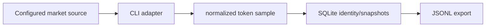

# Token Market Cap Tracker

**Normalize token market observations and retain deduplicated snapshot history.**

  [](LICENSE)

[Overview](#overview) · [Quickstart](#quickstart) · [Example](#example) · [Validation](#validation) · [Documentation](#documentation)

## Overview

A read-only token discovery agent that normalizes market-cap observations and persists deduplicated snapshots.

**Stack:** JavaScript · Node.js 24 · gmgn-cli · SQLite · JSONL · node:test

## Identity and observations have separate lifetimes

| Component | Behavior |
| --- | --- |
| Adapter | The external source CLI is isolated behind an adapter. |
| Normalize | Samples retain market cap, liquidity and source timestamps. |
| Persist | SQLite distinguishes initial token discovery from subsequent snapshots. |

## Processing path



## Quickstart

```console
npm ci --ignore-scripts
npm run check
node --test test/normalize.test.js test/storage.test.js
```

The commands above install prerequisites or run the specified offline checks. Live collection, cloud operations, messaging and trading are separate operational steps when present.

## Example

**Inspect the workflow**

Inspect normalization/storage fixtures to follow a token identity across repeated samples. A first discovery and a later sample represent different events. JSONL output can feed downstream analysis without making a snapshot into a price forecast.

## Configuration and storage

Node.js 24+, SQLite and an external gmgn-cli source. [.env.example](.env.example) defines API access, chain, polling, database, JSONL path and maximum-cycle settings. Live sampling is separate from the offline suite.

## Repository guide

| Location | Responsibility |
| --- | --- |
| [src/gmgn-cli.js](src/gmgn-cli.js) | Source adapter |
| [src/normalize.js](src/normalize.js) | Observation normalization |
| [src/storage.js](src/storage.js) | Identity and snapshot persistence |
| [src/agent.js](src/agent.js) | Polling orchestration |

## Validation

These checks use offline fixtures or controlled backends.

## Scope and operational boundaries

Unit tests do not establish current API access, quotas or sampling reliability. The documented agent flow reads and records observations; token purchase, signing and broadcast are outside it.

## Documentation

- The repository guide above links directly to the implementation and configuration files.

## License and attribution

Project-authored source code is licensed under the [MIT License](LICENSE). Third-party components and datasets retain their respective rights and licenses.
